# 특성 공학(Feature Engineering) 파이프라인 설계 및 전처리·변수 선택 전략 비교

**데이터셋:** Titanic (OpenML ID 40945, 1,309명) · **과제:** 생존 여부 이진 분류
**소스코드:** https://github.com/gymdong/bigdata_assignment/tree/main/Feature_Engineering

> **재현 방법**: `cd Feature_Engineering && uv sync && uv run python -m src.main`
> 데이터 다운로드부터 EDA, 모든 실험, 튜닝, SHAP, 이 PDF 생성까지 명령 한 줄로 다시 실행됩니다.
> 난수 시드는 `random_state=42`로 고정했고, 의존성 버전은 `uv.lock`에 고정되어 있습니다.

## 1. 데이터셋 소개 (STEP 01)

### 1.1 선택 이유
- **지도학습 이진 분류**: 타겟은 `survived` (0 = 사망, 1 = 생존)입니다.
- **수치형 + 범주형 혼합**: 수치형은 age, fare, sibsp, parch이고, 범주형은 sex, embarked, pclass이며, 문자열에서 정보를 뽑아낼 수 있는 name, cabin, ticket도 있습니다.
- **결측치가 실제로 있음**: age 20%, cabin 77%. 결측치 처리 방법 비교가 의미 있는 데이터입니다.
- **샘플 1,309개 (≥ 500 조건 충족)**: Kaggle 원본(train 891개)보다 큰 OpenML 전체본을 사용했습니다. 이 버전은 로그인 없이 `fetch_openml`로 받을 수 있어 재현성 측면에서도 유리합니다.

### 1.2 데이터 shape
```
원본: (1309, 14)   →   누수 컬럼 제거 후 X: (1309, 10), y: (1309,)
학습/평가 분할 (Stratified 80:20): train (1047, 10) / test (262, 10)
```

### 1.3 컬럼 설명

| 컬럼 | 유형 | 설명 | 결측 수 | 고유값 수 | 사용 |
|---|---|---|---|---|---|
| pclass | 범주(순서형) | 객실 등급 (1/2/3등석) | 0 | 3 | O |
| survived | 이진 | **타겟** — 생존 여부 | 0 | 2 | 타겟 |
| name | 문자열 | 승객 이름 (호칭 포함) | 0 | 1307 | 호칭(Title) 추출 |
| sex | 범주 | 성별 | 0 | 2 | O |
| age | 수치 | 나이 | 263 | 98 | O |
| sibsp | 수치 | 동승한 형제자매/배우자 수 | 0 | 7 | O |
| parch | 수치 | 동승한 부모/자녀 수 | 0 | 8 | O |
| ticket | 문자열 | 티켓 번호 | 0 | 929 | 제거 (고유값 과다) |
| fare | 수치 | 운임 (파운드) | 1 | 281 | O |
| cabin | 문자열 | 객실 번호 | 1014 | 186 | 데크(Deck) 추출 |
| embarked | 범주 | 승선 항구 (C/Q/S) | 2 | 3 | O |
| boat | 문자열 | 구명보트 번호 | 823 | 27 | **제거 (타겟 누수)** |
| body | 수치 | 시신 식별 번호 | 1188 | 121 | **제거 (타겟 누수)** |
| home.dest | 문자열 | 거주지/목적지 | 564 | 369 | 제거 |

`boat`(보트에 탔음 → 생존)와 `body`(시신 번호가 있음 → 사망)는 **결과가 나온 뒤에 기록된 정보**입니다. 그대로 쓰면 정확도가 거의 100%로 나와 실험 자체가 의미 없어지므로 처음부터 제거했습니다.

## 2. 탐색적 데이터 분석 (STEP 02)

### 2.1 결측치 비율

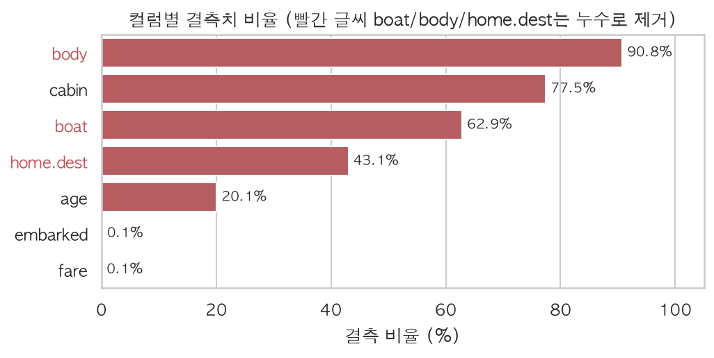

| 컬럼 | 결측 비율 | 처리 방침 |
|---|---|---|
| cabin | 77.5% | 값을 대체하기에는 결측이 너무 많습니다. 대신 데크 문자와 **"객실 정보 있음(HasCabin)" 파생 변수**로 바꿔 씁니다. 결측 여부 자체가 정보이기 때문입니다. |
| age | 20.1% | Mean / Median / Most Frequent / Drop NA를 비교합니다. |
| embarked | 0.15% (2건) | 최빈값으로 대체합니다. |
| fare | 0.08% (1건) | 수치형 결측 처리 방법을 그대로 적용합니다. |

### 2.2 타겟 분포 — 불균형 여부

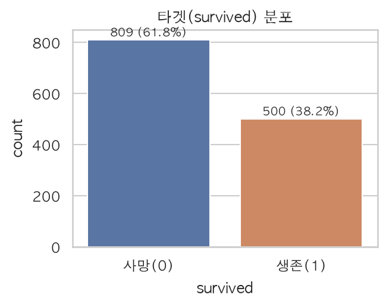

사망 809명(61.8%), 생존 500명(38.2%)으로 **약한 불균형(약 1.6 : 1)**입니다. 오버샘플링이 필요할 정도는 아니라고 판단했습니다. 다만 Accuracy만 보면 결과가 왜곡될 수 있으므로 **F1과 ROC-AUC를 함께 보고**, 데이터 분할과 CV 모두 **층화(Stratified) 방식**으로 클래스 비율을 유지했습니다.

### 2.3 수치형 분포 (Histogram)

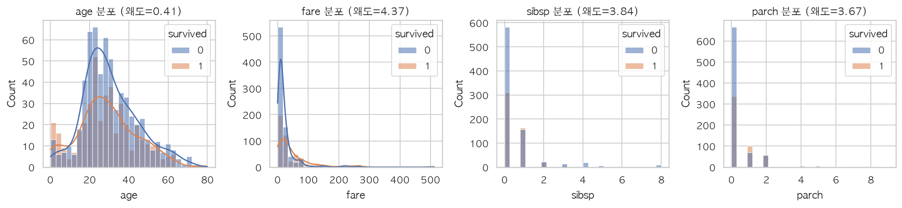

- **fare**는 왜도가 4.37로 오른쪽 꼬리가 매우 깁니다. 최대값 512는 중앙값 14의 약 35배입니다.
- **age**는 거의 정규분포에 가깝고(왜도 0.41), 0~10세 구간에서 생존 비율이 높습니다.
- **sibsp, parch**는 대부분 0이고 드물게 큰 값이 있는 이산형 분포입니다.

### 2.4 이상치 탐색 (Boxplot, IQR 1.5배 기준)

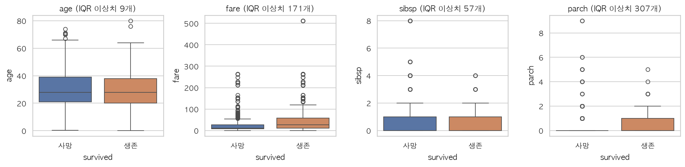

| 변수 | Q1 | Q3 | 상한 | 이상치 수 (비율) | 최대값 | 판단 |
|---|---|---|---|---|---|---|
| age | 21.0 | 39.0 | 66.0 | 9 (0.9%) | 80 | 실제 고령 승객이므로 유지 |
| fare | 7.9 | 31.3 | 66.3 | 171 (13.1%) | 512.3 | 1등석 고가 운임이라 실제 값임 → 유지하되 **RobustScaler** 실험 |
| sibsp | 0 | 1 | 2.5 | 57 (4.4%) | 8 | 대가족, 실제 값 |
| parch | 0 | 0 | 0 | 307 (23.5%) | 9 | IQR이 0이라 0이 아닌 값이 모두 이상치로 잡힘 → IQR 기준이 맞지 않는 분포 |

이상치들이 측정 오류가 아니라 **실제로 존재하는 승객 정보**이므로 제거하지 않았습니다. 대신 이상치에 덜 민감한 RobustScaler와, 이상치 영향을 거의 받지 않는 트리 모델로 대응했습니다. 또 **fare = 0인 승객이 17명** 있는데, 승무원이나 초대 승객으로 보입니다.

### 2.5 범주형 변수와 생존율 (Countplot / Barplot)

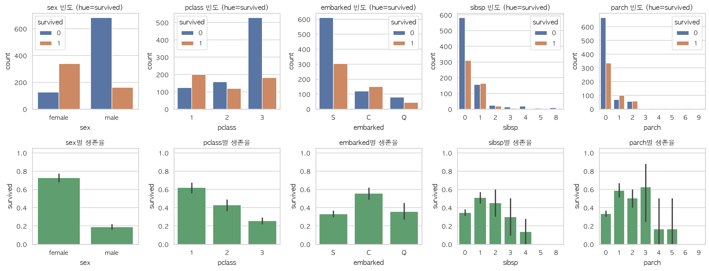

- **성별**: 여성 생존율 72.7%, 남성 19.1%. 가장 강력한 변수입니다. ("여성과 아이 먼저" 원칙)
- **객실 등급**: 1등석 61.9% → 2등석 43.0% → 3등석 25.5%로 등급이 낮을수록 생존율이 떨어집니다.
- **승선 항구**: C(Cherbourg) 생존율이 높습니다. 1등석 승객 비중이 높아서 생긴 간접 효과로 보입니다.
- **sibsp, parch**: 생존율이 단조롭게 변하지 않습니다. 가족 1~3명일 때 가장 높고, 대가족이면 오히려 낮습니다.

### 2.6 상관관계 분석 (Heatmap)

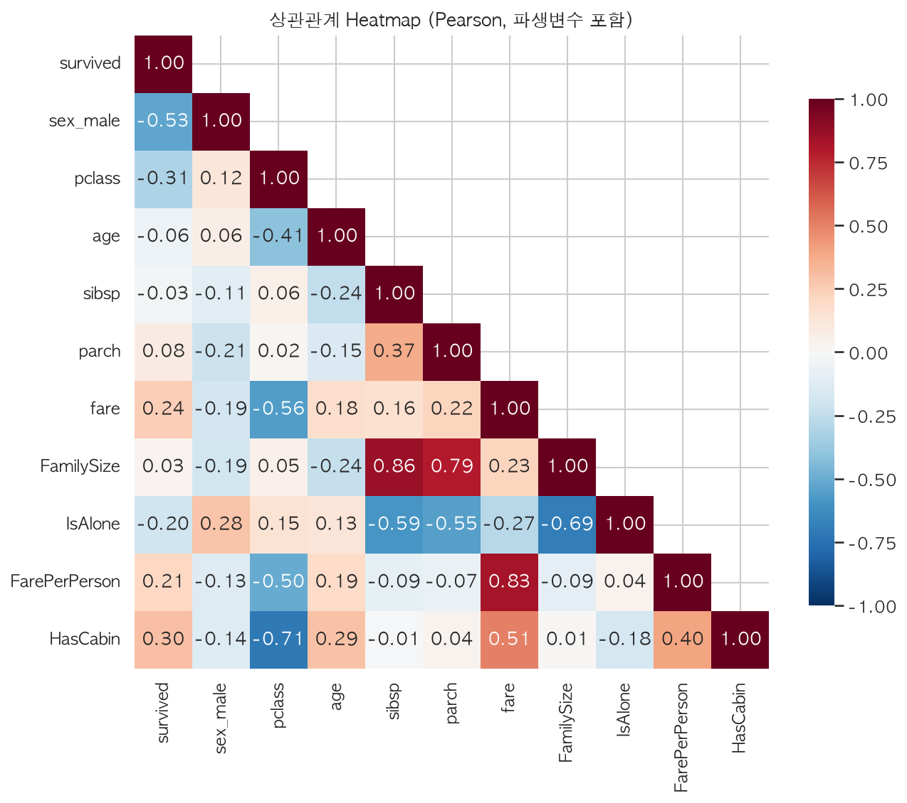

| 변수 | survived와의 상관계수 |
|---|---|
| sex_male | **−0.529** |
| pclass | −0.312 |
| HasCabin (파생) | **+0.302** |
| fare | +0.244 |
| FarePerPerson (파생) | +0.211 |
| IsAlone (파생) | −0.202 |
| FamilySize (파생) | +0.027 |

- 파생 변수인 **HasCabin(+0.30)과 IsAlone(−0.20)** 은 원본 변수인 sibsp(−0.03), parch(+0.08)보다 타겟과의 선형 관계가 훨씬 강합니다.
- 반면 **FamilySize는 상관계수가 0.03에 불과**합니다. 그런데 2.5와 2.7에서 보듯 실제로는 2~4명일 때 생존율이 높고 5명 이상이면 낮은 **역U자형 비선형 관계**가 있습니다. 상관계수만으로 변수를 고르면 이런 변수를 놓친다는 것을 보여주는 예입니다.
- 서로 강하게 얽힌 변수도 있습니다. pclass ↔ fare / HasCabin(−0.56 / −0.71), FamilySize ↔ sibsp / parch(0.86 / 0.79). 다중공선성이 있으므로 변수 선택 단계의 근거가 됩니다.

### 2.7 파생 변수 미리보기

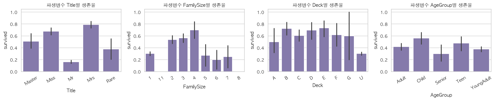

### 2.8 EDA 요약

| 구분 | 내용 |
|---|---|
| **데이터 품질 문제** | ① boat와 body의 타겟 누수 ② cabin 77% 결측 ③ age 20% 결측 ④ fare 극단값과 0원 승객 17명 ⑤ name과 ticket은 고유값이 너무 많은 텍스트 |
| **불균형** | 생존 38.2% 대 사망 61.8%의 약한 불균형 → Stratified 분할과 F1·AUC로 대응 |
| **주요 변수 특징** | 성별, 객실 등급, 호칭(Title)이 핵심입니다. 가족 규모는 비선형이고, 객실 정보 유무가 생존 여부를 상당히 구분합니다. |

## 3. Feature Engineering 과정 (STEP 03)

### 3.1 파이프라인 구조 (`sklearn.Pipeline`)

모든 전처리는 **하나의 `Pipeline` 객체 안**에서 처리됩니다. 그래서 CV의 각 fold마다 학습 데이터에만 `fit`하고, 대체값(평균 등)과 스케일링 기준값이 검증·평가 데이터에 새어 들어가지 않습니다.

```
Pipeline
 ├─ derive  : DerivedFeatures (사용자 정의 Transformer — 파생변수 생성, 텍스트 컬럼 제거)
 ├─ prep    : ColumnTransformer
 │    ├─ num : SimpleImputer(mean|median|most_frequent) → Scaler(Standard|MinMax|Robust|없음)
 │    └─ cat : SimpleImputer(most_frequent) → OneHotEncoder | OrdinalEncoder(Label)
 ├─ select  : SelectFromModel(RandomForest) | RFE | SelectKBest   (선택 사항)
 └─ model   : LogisticRegression | RandomForest | XGBoost | LightGBM
```

### 3.2 파생 변수 (7개 생성 — 필수 2개 이상)

| 파생 변수 | 생성 방법 | 근거 (EDA) |
|---|---|---|
| **FamilySize** | sibsp + parch + 1 | 가족 규모와 생존율의 역U자형 관계 |
| **IsAlone** | FamilySize == 1 | 혼자 탑승하면 생존율 30% (상관 −0.20) |
| **FarePerPerson** | fare / FamilySize | 단체 티켓 운임을 1인당 운임으로 환산 |
| **Title** | name에서 정규식 `,\s*([^.]+)\.`로 추출 → Mr/Mrs/Miss/Master/Rare | Mr 16% 대 Mrs 79% 대 Master(남아) 51% |
| **Deck** | cabin 첫 글자 (결측은 U) | 객실 정보 없음(U) 30% 대 B·D·E 데크 약 70% |
| **HasCabin** | cabin 결측 여부 | 결측 자체가 정보 (상관 +0.30) |
| **AgeGroup** | age를 Child / Teen / YoungAdult / Adult / Senior로 구간화 | 어린이 생존율이 높음 |

모든 파생 변수는 **같은 행 안의 값만으로 계산**합니다. 다른 승객의 정보를 쓰지 않으므로 train과 test 사이에 정보 누수가 생기지 않습니다.

### 3.3 전처리 비교 대상

| 항목 | 비교한 방법 |
|---|---|
| 결측치 처리 (수치형) | **Mean / Median / Most Frequent / Drop NA** (4가지) |
| 결측치 처리 (범주형) | Most Frequent (평균·중앙값은 범주형에 정의되지 않음) |
| 범주형 인코딩 | **One-Hot** (전처리 후 32개 변수) / **Label(Ordinal)** (14개 변수) |
| 스케일링 | **Standard / MinMax / Robust / 없음** (4가지) |

## 4. 변수 선택 (STEP 04)

### 4.1 Random Forest Feature Importance — 상위 10개 선정

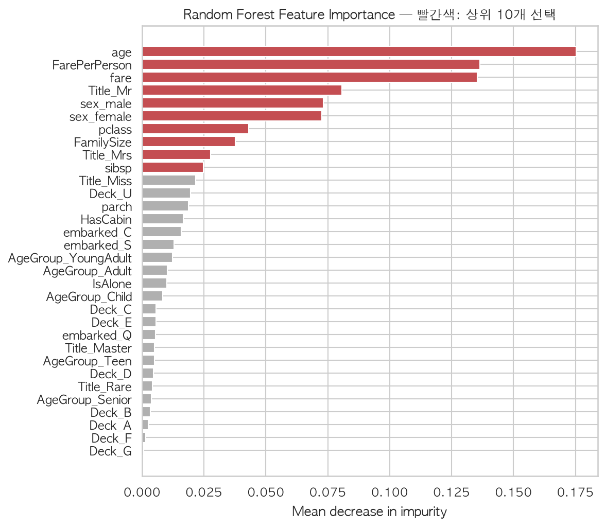

One-Hot 인코딩과 파생 변수를 적용한 32개 변수 중 RF 중요도 상위 10개는 다음과 같습니다.
`age, FarePerPerson, fare, Title_Mr, sex_male, sex_female, pclass, FamilySize, Title_Mrs, sibsp`.
이 중 4개가 **파생 변수**(FarePerPerson, Title_Mr, FamilySize, Title_Mrs)입니다.

> 주의: RF의 impurity 기반 중요도는 **고유값이 많은 연속형 변수(age, fare)를 과대평가**하는 경향이 있습니다. 6.3절에서 permutation 중요도, SHAP와 비교하며 다시 확인합니다.

### 4.2 선택 변수 수(k)에 따른 성능과 과적합

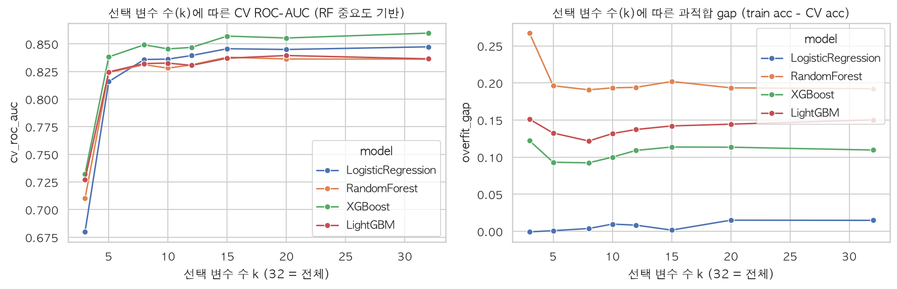

| k (RF 중요도) | LR CV-AUC | RF CV-AUC | XGB CV-AUC | LGBM CV-AUC | RF 과적합 gap | XGB 과적합 gap |
|---|---|---|---|---|---|---|
| 3 | 0.680 | 0.710 | 0.732 | 0.727 | 0.267 | 0.122 |
| 5 | 0.816 | 0.824 | 0.838 | 0.825 | 0.196 | 0.093 |
| 8 | 0.836 | 0.831 | 0.849 | 0.832 | 0.191 | 0.092 |
| **10** | 0.836 | 0.828 | 0.846 | 0.833 | 0.193 | 0.100 |
| 15 | 0.846 | 0.838 | 0.857 | 0.837 | 0.202 | 0.114 |
| 32 (전체) | **0.847** | 0.836 | **0.860** | 0.837 | 0.192 | 0.110 |

### 4.3 선택 방법 비교 (k = 10)

| 방법 | LR | RF | XGB | LGBM | RF 과적합 gap |
|---|---|---|---|---|---|
| RF 중요도 (SelectFromModel) | 0.836 | 0.828 | 0.846 | 0.833 | 0.193 |
| RFE (LogisticRegression) | 0.830 | 0.825 | 0.833 | 0.833 | **0.036** |
| SelectKBest (ANOVA F) | 0.826 | 0.810 | 0.842 | 0.836 | 0.156 |
| 선택 안 함 (32개) | 0.847 | 0.836 | 0.860 | 0.837 | 0.192 |

(수치는 5-fold CV ROC-AUC)

**선택 전/후 비교 정리**
- 변수를 **32개에서 8~10개로 줄여도 CV-AUC는 0.004~0.015만 떨어집니다.** 변수를 70% 줄여도 성능이 거의 유지되므로, 정보 대부분이 상위 변수에 몰려 있다는 뜻입니다.
- 반대로 **k = 3**까지 줄이면 AUC가 0.10 이상 크게 떨어집니다. 남는 변수가 age, fare, FarePerPerson처럼 연속형뿐이라 **성별 정보가 빠지기 때문**입니다. impurity 중요도의 편향이 그대로 드러나는 부분입니다.
- **RFE(LR 기반)로 고른 변수를 쓰면 RF의 과적합 gap이 0.19에서 0.036으로 크게 줄었습니다.** RFE는 sex, Title 같은 **이진 변수**를 주로 고르기 때문에, 트리가 age나 fare 같은 연속형 변수를 잘게 쪼개 학습 데이터를 외우는 일이 줄어듭니다.

## 5. 모델 학습 및 평가 (STEP 05)

### 5.1 평가 설계
- **모델 4종**: Logistic Regression, Random Forest, XGBoost, LightGBM
- **평가 지표 5종**: Accuracy, Precision, Recall, F1, ROC-AUC
- **평가 방식**:
  - train(80%) 안에서 **Stratified 5-fold CV** 평균을 주 비교 기준으로 씁니다.
  - test(20%, 262명)는 마지막에 한 번만 평가합니다.
  - **과적합 gap** = CV train accuracy − CV validation accuracy
- **Base 정의**: 원본 수치형 5개(pclass, age, sibsp, parch, fare)만 사용하고, 결측치 처리·인코딩·스케일링·파생 변수·변수 선택을 모두 하지 않습니다.
  - 범주형은 인코딩 없이 모델에 넣을 수 없어서 제외됩니다.
  - 결측(NaN)은 그대로 두고 트리 모델의 **내장 결측 처리**에 맡깁니다.
  - NaN을 받을 수 없는 LR에만 최소 조건으로 0을 채웠습니다.

### 5.2 필수 실험 비교표

| 실험 | 결측치 처리 | 인코딩 | 스케일링 | Feature Selection |
|---|---|---|---|---|
| Base | 없음 | 없음 | 없음 | 없음 |
| Exp-1 | Mean | One-Hot | Standard | X |
| Exp-2 | Median | Label | MinMax | O (RF 중요도 top 10) |
| Exp-3 | Most Frequent | One-Hot | Robust | O (RF 중요도 top 10) |

(Exp-1~3은 모두 파생 변수 7개를 포함합니다.)

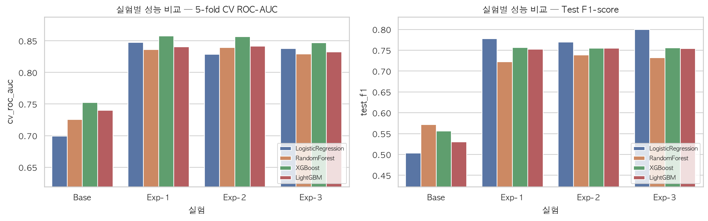

| 실험 | 모델 | CV Acc | CV F1 | CV AUC | gap | Test Acc | Test Prec | Test Rec | Test F1 | Test AUC | 변수 수 |
|---|---|---|---|---|---|---|---|---|---|---|---|
| Base | LR | 0.693 | 0.508 | 0.699 | 0.000 | 0.676 | 0.606 | 0.430 | 0.503 | 0.715 | 5 |
| Base | RF | 0.702 | 0.593 | 0.726 | 0.254 | 0.679 | 0.583 | 0.560 | 0.571 | 0.708 | 5 |
| Base | XGB | 0.722 | 0.590 | 0.752 | 0.110 | 0.683 | 0.598 | 0.520 | 0.556 | 0.727 | 5 |
| Base | LGBM | 0.712 | 0.581 | 0.740 | 0.143 | 0.676 | 0.593 | 0.480 | 0.530 | 0.716 | 5 |
| Exp-1 | LR | 0.799 | 0.729 | 0.848 | 0.015 | 0.832 | 0.786 | 0.770 | 0.778 | 0.880 | 32 |
| Exp-1 | RF | 0.782 | 0.712 | 0.836 | 0.195 | 0.782 | 0.705 | 0.740 | 0.722 | 0.857 | 32 |
| Exp-1 | XGB | 0.800 | 0.724 | **0.858** | 0.114 | 0.821 | 0.785 | 0.730 | 0.757 | 0.884 | 32 |
| Exp-1 | LGBM | 0.787 | 0.710 | 0.840 | 0.148 | 0.817 | 0.777 | 0.730 | 0.753 | 0.876 | 32 |
| Exp-2 | LR | 0.776 | 0.696 | 0.829 | 0.009 | 0.828 | 0.790 | 0.750 | 0.769 | 0.875 | 10 |
| Exp-2 | RF | 0.780 | 0.711 | 0.839 | 0.194 | 0.798 | 0.728 | 0.750 | 0.739 | 0.865 | 10 |
| Exp-2 | XGB | 0.806 | 0.733 | 0.857 | 0.106 | 0.817 | 0.771 | 0.740 | 0.755 | 0.896 | 10 |
| Exp-2 | LGBM | 0.788 | 0.712 | 0.842 | 0.144 | 0.817 | 0.771 | 0.740 | 0.755 | 0.884 | 10 |
| Exp-3 | LR | 0.791 | 0.719 | 0.838 | 0.007 | **0.851** | **0.821** | **0.780** | **0.800** | 0.880 | 10 |
| Exp-3 | RF | 0.781 | 0.708 | 0.829 | 0.192 | 0.802 | 0.755 | 0.710 | 0.732 | 0.870 | 10 |
| Exp-3 | XGB | **0.807** | **0.736** | 0.847 | 0.093 | 0.824 | 0.807 | 0.710 | 0.755 | **0.898** | 10 |
| Exp-3 | LGBM | 0.805 | 0.734 | 0.833 | 0.120 | 0.821 | 0.791 | 0.720 | 0.754 | 0.875 | 10 |

**실험별 4개 모델 평균**

| 실험 | CV AUC | Test AUC | Test F1 | 과적합 gap |
|---|---|---|---|---|
| Base | 0.729 | 0.717 | 0.540 | 0.127 |
| Exp-1 | **0.846** | 0.874 | 0.752 | 0.118 |
| Exp-2 | 0.842 | 0.880 | 0.755 | 0.113 |
| Exp-3 | 0.837 | **0.881** | **0.760** | **0.103** |

- **Base → Exp-1~3**: CV AUC가 평균 **+0.107 ~ +0.116**, Test F1이 **+0.21 ~ +0.22** 올랐습니다. 전처리를 통해 **성별과 호칭 같은 범주형 정보를 모델에 넣을 수 있게 된 것**이 가장 큰 차이를 만들었습니다.
- Exp-1, 2, 3끼리의 차이는 CV AUC 기준 0.01 이내입니다. 이는 **CV fold 간 표준편차(평균 0.015)보다 작습니다.** 따라서 Exp-1~3 중 어느 것이 확실히 더 낫다고 말할 수는 없습니다.
- 필수 비교표는 결측치, 인코딩, 스케일링, 변수 선택이 **동시에 바뀌기 때문에**, 어느 요인 때문에 성능이 달라졌는지 분리할 수 없습니다. 그래서 5.3절에서 **한 번에 한 요인만 바꾸는 ablation 실험**을 추가로 수행했습니다.

### 5.3 단일 요인 Ablation

기준 설정은 `Median / One-Hot / Standard / 파생 변수 O / FS X`이고, 여기서 한 요인만 바꿔 가며 비교했습니다.

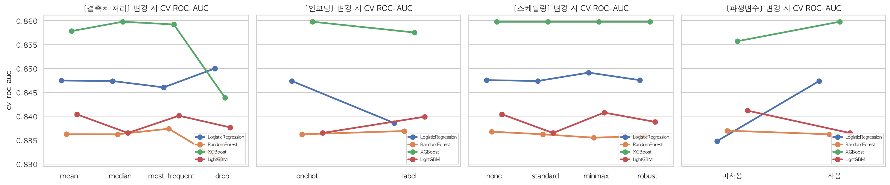

**5-fold CV ROC-AUC**

| 요인 | 수준 | LR | RF | XGB | LGBM |
|---|---|---|---|---|---|
| 결측치 | Mean | 0.8475 | 0.8362 | 0.8578 | 0.8404 |
| | Median | 0.8474 | 0.8362 | **0.8598** | 0.8365 |
| | Most Frequent | 0.8460 | **0.8374** | 0.8592 | 0.8401 |
| | Drop NA (train 837행) | **0.8500** | 0.8310 | 0.8439 | 0.8377 |
| 인코딩 | One-Hot | **0.8474** | 0.8362 | **0.8598** | 0.8365 |
| | Label | 0.8386 | **0.8369** | 0.8575 | **0.8399** |
| 스케일링 | 없음 | 0.8476 | **0.8368** | 0.8598 | 0.8404 |
| | Standard | 0.8474 | 0.8362 | 0.8598 | 0.8365 |
| | MinMax | **0.8491** | 0.8355 | 0.8598 | **0.8408** |
| | Robust | 0.8475 | 0.8359 | 0.8598 | 0.8388 |
| 파생 변수 | 미사용 | 0.8348 | **0.8370** | 0.8557 | **0.8412** |
| | 사용 | **0.8474** | 0.8362 | **0.8598** | 0.8365 |

**해석**
1. **결측치 처리**
   - Mean, Median, Most Frequent의 차이는 0.002 이내로 거의 없습니다. 대체 대상인 age의 분포가 거의 대칭이라 평균과 중앙값이 비슷하기 때문입니다(29.9 대 28.0).
   - **Drop NA는 학습 데이터의 20%(210행)를 버리게 되어 트리 모델 성능이 떨어졌습니다**(XGB −0.016, RF −0.005, test AUC 기준 −0.01 ~ −0.02). 또 실제 서비스에서는 결측이 있는 승객을 예측할 수 없다는 한계도 있습니다.
2. **인코딩**
   - **LR은 One-Hot이 Label보다 AUC가 0.009 높습니다.** Label 인코딩은 Title을 0~4 정수로 바꾸는데, 이러면 "Mr < Mrs < Miss" 같은 존재하지 않는 순서를 선형 모델이 그대로 가정하게 됩니다.
   - 반면 **트리 모델(RF, LGBM)은 Label이 같거나 오히려 약간 낫습니다.** 트리는 분할을 여러 번 하면 순서와 상관없이 범주를 나눌 수 있고, 변수가 32개에서 14개로 줄어 분할 후보가 효율적으로 바뀝니다.
3. **스케일링**
   - **XGBoost는 네 가지 스케일링에서 AUC가 소수점 넷째 자리까지 완전히 같습니다(0.8598).** 트리는 값의 순서만 쓰므로 단조 변환에 영향을 받지 않습니다.
   - RF와 LGBM도 차이가 0.004 이내입니다.
   - **LR만 영향을 받으며**, MinMax가 가장 좋았습니다(0.8491). 스케일링하지 않아도 크게 떨어지지 않은 이유는, LR의 L2 규제가 이미 변수 크기 차이를 어느 정도 흡수했기 때문으로 보입니다.
4. **파생 변수**
   - **LR은 +0.013으로 가장 큰 효과**를 봤습니다. 선형 모델은 "가족 규모의 역U자형"이나 "호칭" 같은 비선형·텍스트 정보를 스스로 만들어낼 수 없어서, 사람이 만들어 준 변수의 효과가 큽니다.
   - XGB는 +0.004로 소폭 올랐고, RF와 LGBM은 오히려 약간 떨어졌습니다(−0.001 / −0.005). 트리 모델은 sex × age × sibsp 조합으로 Title이나 FamilySize와 비슷한 정보를 스스로 학습할 수 있습니다. 여기에 비슷한 변수가 추가되면 과적합 gap이 커집니다(LGBM 0.127 → 0.150).

### 5.4 하이퍼파라미터 튜닝 (GridSearchCV) — 가산점

기준 파이프라인 전체를 대상으로 GridSearchCV를 돌렸습니다. 이때 모델 하이퍼파라미터뿐 아니라 **전처리 설정(결측치 대체 전략, 스케일러)도 탐색 공간에 넣었습니다.** (scoring = ROC-AUC, 5-fold)

| 모델 | 탐색 조합 수 | 최적 파라미터 |
|---|---|---|
| LR | 36 | C=0.1, imputer=mean, scaler=RobustScaler |
| RF | 48 | max_depth=None, max_features=0.5, **min_samples_leaf=5**, imputer=mean |
| XGB | 64 | **max_depth=2**, learning_rate=0.1, n_estimators=200, min_child_weight=1, imputer=mean |
| LGBM | 72 | num_leaves=15, learning_rate=0.03, n_estimators=200, **min_child_samples=40**, imputer=median |

| 모델 | 설정 | CV AUC | 과적합 gap | Test Acc | Test Prec | Test Rec | Test F1 | Test AUC |
|---|---|---|---|---|---|---|---|---|
| LR | 기본 | 0.8474 | 0.015 | 0.828 | 0.778 | 0.770 | 0.774 | 0.880 |
| LR | **튜닝** | 0.8482 | 0.011 | **0.844** | 0.804 | **0.780** | **0.792** | 0.883 |
| RF | 기본 | 0.8362 | 0.192 | 0.794 | 0.721 | 0.750 | 0.735 | 0.855 |
| RF | **튜닝** | 0.8587 | **0.071** | 0.840 | **0.822** | 0.740 | 0.779 | 0.896 |
| XGB | 기본 | 0.8598 | 0.110 | 0.821 | 0.773 | 0.750 | 0.761 | 0.889 |
| XGB | **튜닝** | **0.8631** | **0.056** | 0.828 | 0.802 | 0.730 | 0.764 | **0.897** |
| LGBM | 기본 | 0.8365 | 0.150 | 0.821 | 0.785 | 0.730 | 0.757 | 0.876 |
| LGBM | **튜닝** | 0.8604 | 0.080 | 0.817 | 0.783 | 0.720 | 0.750 | 0.893 |

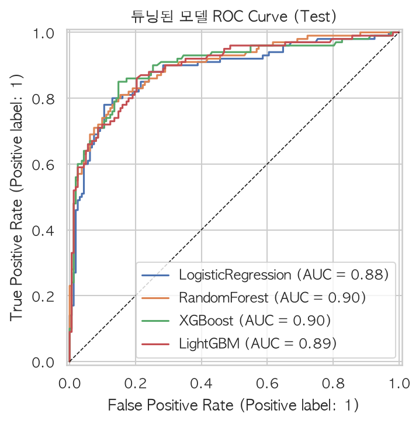

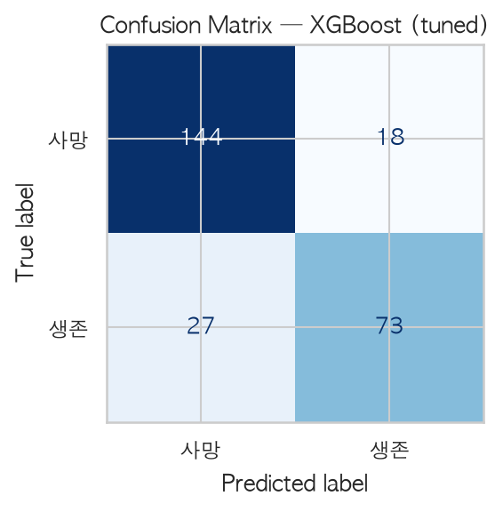

- 세 트리 모델 모두 **모델이 단순해지는 쪽**(얕은 트리, 큰 leaf 최소 크기)으로 최적값이 정해졌습니다. 그 결과 **과적합 gap이 약 절반 이하로 줄었고**, RF와 LGBM은 CV AUC도 +0.02 이상 올랐습니다(XGB는 +0.003). 데이터가 1,000개 수준이라 **규제를 거는 것이 가장 효과적인 개선 수단**이었습니다.
- 튜닝 효과(RF +0.023, LGBM +0.024)는 앞의 전처리 조합 간 차이(≤ 0.01)보다 큽니다.
- **최종 모델**: CV AUC 기준으로 튜닝된 **XGBoost**를 선택했습니다(CV AUC 0.863, Test AUC 0.897). Test Accuracy와 F1은 튜닝된 LR이 가장 높아서, 이 데이터에서는 단순한 선형 모델도 충분히 경쟁력이 있습니다.

## 6. 설명 가능성 분석 (SHAP) & Feature Importance 시각화 고도화 — 가산점

### 6.1 SHAP Summary (튜닝된 XGBoost, test 262명)

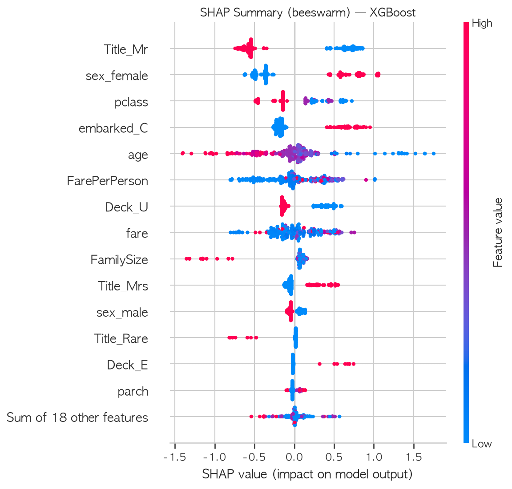

- **Title_Mr = 1(성인 남성)** 이면 SHAP 값이 약 −0.6으로 생존 확률을 가장 크게 낮춥니다. 이 효과는 sex_male보다 큽니다. 이유는 Title이 **성별에 나이 정보까지 합친 변수**이기 때문입니다. 같은 남성이라도 Master(남아)는 생존율이 51%입니다.
- **pclass**가 높을수록(3등석) 생존 확률이 낮아지고, **age**가 낮을수록(어린이) 생존 확률이 크게 높아집니다(최대 +1.7).
- **FamilySize**가 클 때(빨간 점) SHAP 값이 −1.3까지 떨어집니다. EDA에서 본 "대가족은 생존율 낮음"이라는 비선형 효과를 모델이 학습했다는 뜻입니다.
- **Deck_U(객실 정보 없음)** 이면 생존 확률이 낮아집니다. 결측 여부를 파생 변수로 만든 것이 실제로 쓸모 있었습니다.

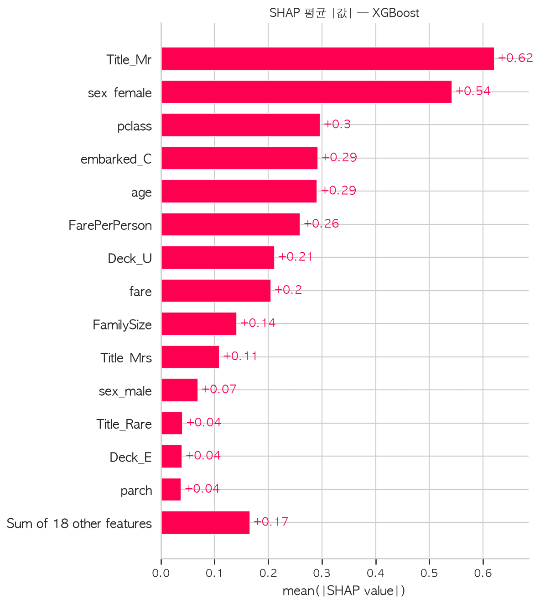

### 6.2 SHAP Dependence

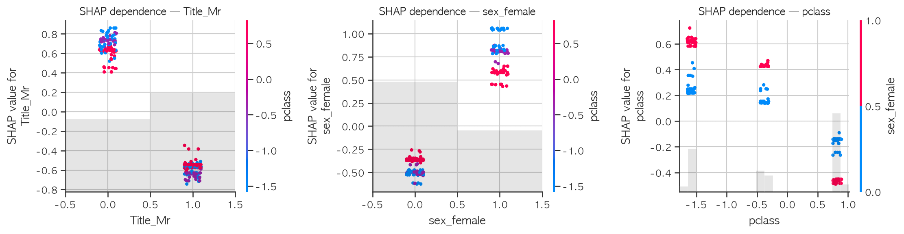

pclass의 dependence plot을 보면 상호작용이 드러납니다. **여성(빨강)은 1·2등석에서 생존 효과가 크게 양(+)이지만, 3등석에서는 −0.45로 급락합니다.** 남성(파랑)은 등급에 따른 변화폭이 작습니다. 즉 "여성 우선" 원칙이 3등석에서는 잘 지켜지지 않았다는 해석이 가능합니다.

### 6.3 세 가지 중요도 비교

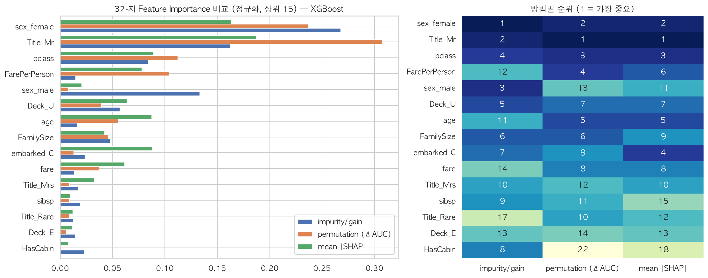

| 변수 | impurity/gain 순위 | permutation 순위 | mean SHAP 순위 |
|---|---|---|---|
| sex_female | 1 | 2 | 2 |
| Title_Mr | 2 | 1 | 1 |
| pclass | 4 | 3 | 3 |
| **sex_male** | **3** | **13** | **11** |
| **FarePerPerson** | **12** | **4** | **6** |
| age | 11 | 5 | 5 |
| HasCabin | 8 | 22 | 18 |

- **sex_male**은 gain 기준으로는 3위지만 permutation 기준으로는 13위입니다. One-Hot 인코딩에서 sex_female과 **완전히 중복되는 정보**이기 때문입니다. 한쪽 값을 섞어도 다른 쪽에 같은 정보가 남아 있어서 성능이 떨어지지 않습니다. One-Hot 인코딩은 중요도 해석을 왜곡할 수 있다는 점을 보여줍니다.
- **FarePerPerson과 age**는 gain 기준으로는 낮은 순위지만, permutation과 SHAP 기준으로는 상위 6위 안에 듭니다. 분할 한 번당 이득은 작아도, 여러 번 나눠 쓰이면서 예측 전반에 꾸준히 기여한다는 뜻입니다.
- 결론적으로 **impurity 기반 중요도 하나만 믿고 변수를 고르면 위험합니다.** 4.2절의 k = 3 실패 사례도 같은 이유입니다. 모델과 무관한 permutation 중요도나 SHAP로 교차 검증하는 것이 바람직합니다.

## 7. 최종 결론

### Q1. 어떤 전처리 전략이 가장 효과적이었는가?
**"범주형 변수를 모델에 넣을 수 있게 만든 것(인코딩)"과 "도메인 지식 기반 파생 변수"가 가장 효과적이었습니다.**
- Base에서 Exp-1로 가면 CV AUC(4개 모델 평균)가 0.729에서 0.846으로 +0.116 오릅니다. 성별과 호칭이 들어간 효과입니다.
- 반면 결측치 대체 방법(Mean/Median/Most Frequent)이나 스케일러 종류에 따른 차이는 0.002~0.004로 CV 표준편차(0.015)보다 훨씬 작아 **실질적인 차이가 없었습니다.**
- 예외적으로 **Drop NA는 데이터 20%를 잃어 트리 모델 성능을 떨어뜨렸으므로 피해야 합니다.**
- 종합하면 **Median 또는 Mean 대체 + One-Hot + (LR이라면) 스케일링 + 파생 변수 + 규제 중심의 튜닝**이 가장 안정적이었습니다.

### Q2. One-Hot Encoding이 항상 좋은가?
**아닙니다. 모델에 따라 다릅니다.**
- **선형 모델(LR)에서는 One-Hot이 필수에 가깝습니다**(Label 대비 +0.009 AUC). Label 인코딩은 존재하지 않는 순서를 가정하게 만들기 때문입니다.
- **트리 모델(RF, LGBM)에서는 Label이 같거나 약간 더 좋았습니다.** 변수 수도 32개에서 14개로 줄어 효율적입니다.
- One-Hot의 단점도 확인했습니다. sex_male과 sex_female처럼 **중복된 변수가 생겨 중요도 해석이 왜곡**됩니다. 범주가 많은 변수에서는 차원이 크게 늘어나는 문제도 있습니다.

### Q3. Feature Selection이 과적합 감소에 기여했는가?
**방법에 따라 다르며, "제한적으로 기여"했습니다.**
- **RF 중요도 기반 선택**은 32개를 10개로 줄여도 과적합 gap이 거의 줄지 않았습니다(RF 0.192 → 0.193, XGB 0.110 → 0.100). 선택된 변수가 age, fare 같은 연속형 위주라 트리가 여전히 데이터를 외울 수 있기 때문입니다.
- **RFE(LR 기반) 선택**은 RF의 과적합 gap을 **0.192에서 0.036으로 크게 줄였고**, CV AUC 손실은 0.011에 그쳤습니다.
- 다만 과적합을 줄이는 데는 **하이퍼파라미터 규제(GridSearchCV)가 더 효과적**이었습니다. 이 방법은 gap을 약 절반으로 줄이면서 AUC도 올렸습니다(RF·LGBM +0.02).
- 변수 선택의 진짜 장점은 **변수 70%를 버려도 성능이 거의 그대로라는 점**입니다. 모델이 단순해지고 해석하기 쉬워집니다.

### Q4. 스케일링이 모델별로 어떤 영향을 미쳤는가?
- **트리 계열(XGB, RF, LGBM)**: 거의 영향이 없습니다. XGBoost는 네 가지 스케일링에서 AUC가 소수점 넷째 자리까지 같았습니다(0.8598). 트리는 값의 순서만 사용하기 때문입니다.
- **Logistic Regression**: 유일하게 영향을 받는 모델입니다. MinMax(0.8491)가 가장 좋았고, 튜닝 결과 RobustScaler가 선택되었습니다(fare 이상치에 강함).
- 결국 **스케일링은 거리나 계수 크기에 민감한 모델에만 필요한 전처리**입니다. 트리 모델에서는 생략해도 됩니다.

### Q5. Feature Engineering이 실제 성능 향상에 얼마나 기여했는가?

| 단계 | CV AUC (XGBoost) | 누적 향상 |
|---|---|---|
| Base (원본 수치형 5개) | 0.752 | — |
| + 인코딩·결측치 처리 (파생 변수 X) | 0.856 | +0.104 |
| + 파생 변수 7개 | 0.860 | +0.108 |
| + GridSearchCV 튜닝 | **0.863** | **+0.111** |

| 단계 | CV AUC (LogisticRegression) | 누적 향상 |
|---|---|---|
| Base | 0.699 | — |
| + 인코딩·결측치 처리·스케일링 | 0.835 | +0.135 |
| + 파생 변수 7개 | 0.847 | +0.148 |
| + 튜닝 | 0.848 | +0.149 |

- 특성 공학 전체로 **CV AUC가 +0.11 ~ +0.15, Test F1이 0.54에서 0.76~0.80으로 약 +0.22 ~ +0.26** 올랐습니다. 이 과제에서 가장 큰 성능 향상 요인입니다.
- 그중 **파생 변수의 기여는 모델에 따라 다릅니다.** 표현력이 약한 LR에서는 +0.013으로 의미가 있었지만, 트리 모델에서는 +0.004 ~ −0.005로 거의 효과가 없었습니다.
- 그래도 SHAP 분석에서 **Title_Mr, FarePerPerson, FamilySize, Deck_U 같은 파생 변수가 상위 10위 안에 들었습니다.** 성능 숫자로는 작아 보여도, **모델이 사람이 이해할 수 있는 형태의 근거로 판단하게 만든다는 점**에서 가치가 있습니다.

### 한계 및 개선 방향
- test가 262명이라 test 지표의 표준오차가 ±0.02~0.03 수준입니다. 그래서 **CV 평균을 주 기준으로 삼았고**, 작은 차이(< 0.01)는 통계적으로 유의하지 않다고 봐야 합니다. 반복 CV나 부트스트랩 신뢰구간을 쓰면 더 엄밀하게 검정할 수 있습니다.
- 개선 아이디어:
  - 같은 티켓을 쓰는 그룹의 생존율(가족 단위 생존) 같은 **그룹 기반 파생 변수**. 다만 fold 안에서만 계산해야 누수가 생기지 않습니다.
  - age를 Title별 중앙값으로 대체하는 **조건부 대체** 또는 IterativeImputer
  - Stacking 앙상블
