# 스트리밍 알고리즘 구현 및 정확도·메모리 트레이드오프 분석

**Bloom Filter · Count-Min Sketch · HyperLogLog (+ Flajolet–Martin 비교) — MovieLens 1M 평점 스트림**

- 소스코드: <https://github.com/gymdong/bigdata_assignment/tree/main/Streaming_Algorithms>
- 재현: `cd Streaming_Algorithms && uv sync && uv run python -m src.main` (데이터 다운로드부터 PDF 생성까지 전부 자동)

> **요약.** MovieLens 1M 평점 스트림(1,000,209건)을 한 번만 읽으면서 세 가지 스케치를 직접 구현해 정확한 set/dict와 비교했다.
>
> - **Bloom Filter** (1.2 MB): FPR **0.815%** (이론 0.819%), 거짓 음성 0건. 정확한 set(71.6 MB)보다 **60배** 작다.
> - **HyperLogLog** (p=14, 16 KB): 고유 쌍 100만 개를 표준편차 **0.84%**(이론 0.81%)로 추정했다. set보다 **4,585배** 작고, 스케치 중 가장 빠르다.
> - **Count-Min Sketch** (272×5, 5.3 KB): 이론 상한(εN)은 100% 지켰다. 그러나 3,706종을 272칸에 몰아넣어 롱테일 영화의 상대오차가 수백~수천 %에 달했다. Conservative Update가 평균오차를 **52% 줄였다**.
> - 파라미터를 늘린다고 항상 좋아지지는 않았다. Bloom의 k를 최적값 이상으로 늘리거나, 같은 메모리에서 CMS의 depth를 키우거나, FM의 버킷 수를 키우면 **오히려 정확도가 나빠졌다**.

## 1. 데이터셋 설명

| 항목 | 값 |
|---|---|
| 데이터셋 | MovieLens 1M (GroupLens), `ratings.dat` |
| 형식 | 텍스트, 한 줄당 1건: `UserID::MovieID::Rating::Timestamp` |
| 레코드 수 | **1,000,209건** (조건 100,000건 이상 충족) |
| 파일 크기 | 23.5 MB |
| 고유 사용자 / 영화 | 6,040명 / 3,706편 |
| 고유 (user, movie) 쌍 | 1,000,209개 (모든 평점이 서로 다른 쌍; 전체 가능한 쌍 대비 밀도 4.47%) |
| 기간 | 2000-04-25 ~ 2003-02-28 |
| 평점 분포 (1~5점) | 1점 5.6% / 2점 10.8% / 3점 26.1% / 4점 34.9% / 5점 22.6% |

이 평점 로그를 **시간 순서와 무관하게 파일에 기록된 순서대로 한 줄씩 들어오는 사용자 이벤트 스트림**으로 보고 처리했다. `src/data.py`의 `stream_ratings()`는 파일을 한 줄씩 읽어 파싱하는 제너레이터로, 전체 데이터를 메모리에 올리지 않는다. 실험마다 파일을 처음부터 다시 읽어 "스트림을 한 번 통과(one pass)"하는 상황을 재현했다.

알고리즘별로 스트림에서 뽑은 원소는 다음과 같다.

| 알고리즘 | 스트림 원소(키) | 질문 |
|---|---|---|
| Bloom Filter | `"user:movie"` (100만 개) | "사용자 u가 영화 m을 이미 평가했는가?" (중복 이벤트 필터 / 추천 후보 제외) |
| Count-Min Sketch | `"movie"` (3,706종, 총 100만 회) | "영화 m은 지금까지 몇 번 평가되었는가?" (인기도 / Top-K) |
| HyperLogLog | `"user"`, `"movie"`, `"user:movie"` | "지금까지 고유 사용자 / 영화 / 쌍은 몇 개인가?" (UV, DAU) |

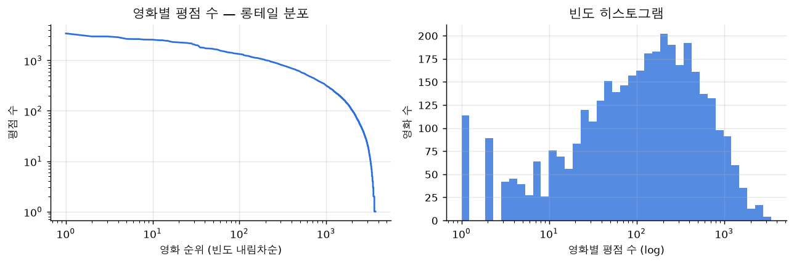

영화 빈도는 전형적인 **롱테일**이다. 최다 영화는 3,428회, 중앙값은 123회, 10회 이하인 영화가 473편이고, 상위 10% 영화가 전체 평점의 44.4%를 차지한다. 이 편향은 Count-Min Sketch의 오차 분석에서 핵심 변수가 된다.

## 2. 선택한 알고리즘 개요

| 알고리즘 | 목적 | 자료구조 | 오차 성격 | 이론 보장 |
|---|---|---|---|---|
| **Bloom Filter** | 포함 여부 | m비트 배열 + k개 해시 | 거짓 양성만 있음 (FN = 0) | FPR ≈ (1 − e^(−kn/m))^k, 최적 k* = (m/n)·ln2 |
| **Count-Min Sketch** | 빈도 추정 | d × w 카운터 행렬 | 과대추정만 있음 (f̂ ≥ f) | w = ⌈e/ε⌉, d = ⌈ln(1/δ)⌉ 이면 P[f̂ − f ≤ εN] ≥ 1 − δ |
| **HyperLogLog** | 고유 개수 추정 | m = 2^p개 소형 레지스터 | 양방향 (불편 추정) | 표준오차 ≈ 1.04/√m |
| Flajolet–Martin (PCSA) | 고유 개수 (비교 기준선) | m개 32비트 비트맵 | 양방향, 작은 n에서 편향 | 표준오차 ≈ 0.78/√m |

- **Bloom Filter**: 원소를 k개의 해시 위치에 비트로 표시한다. 질의 시 k개 비트가 모두 1이면 "있을 수 있음", 하나라도 0이면 "확실히 없음"이다. 원소 자체를 저장하지 않으므로 원소 크기와 무관하게 원소당 몇 비트만 쓴다.
- **Count-Min Sketch**: 각 행이 독립 해시로 원소를 w개 칸 중 하나에 매핑하고 카운터를 증가시킨다. 다른 원소와의 충돌은 카운터를 키우기만 하므로 d개 행의 **최솟값**이 가장 덜 오염된 추정치가 된다. 개선형인 **Conservative Update(CU)**도 함께 구현했다. CU는 현재 최솟값 + 1보다 작은 칸만 올려서 불필요한 증가를 줄인다.
- **HyperLogLog**: 해시값의 상위 p비트로 버킷을 고르고, 나머지 비트의 선행 0 개수 + 1(ρ)의 최댓값을 버킷마다 기록한다. 균등 해시에서 ρ ≥ r일 확률은 2^(−(r−1))이므로, 최댓값은 고유 원소 수의 로그를 반영한다. 버킷 추정치를 **조화평균**으로 합쳐 이상치에 강하다. 작은 n에서는 Linear Counting으로 보정한다.
- **Flajolet–Martin (PCSA)**: HLL의 전신이다. 각 버킷에 trailing zero 위치를 비트맵으로 기록하고 "가장 낮은 0비트"의 평균으로 추정한다. 같은 m에서는 HLL보다 오차 상수가 작지만, 레지스터가 32비트라 **같은 메모리 기준**으로는 불리하다. 이 점을 실험으로 확인한다.

## 3. 구현 방식

모든 알고리즘은 **외부 라이브러리 없이 순수 Python으로 직접 구현**했다. 해시 함수만 표준 라이브러리 `hashlib.blake2b`를 사용했다.

| 파일 | 내용 |
|---|---|
| `src/hashing.py` | 원소당 BLAKE2b-128 **1회** 계산 → (h1, h2) 64비트 2개. seed는 BLAKE2b key로 넣어 seed별 독립 해시 계열을 만든다. |
| `src/bloom.py` | `BloomFilter(m, k)`: `bytearray` 비트 배열(8비트/바이트 패킹), Kirsch–Mitzenmacher double hashing g_i = h1 + i·h2 mod m |
| `src/cms.py` | `CountMinSketch(w, d, conservative)`: `array('I')` 1차원 d·w 카운터(4바이트), 행별 열 = (h1 + i·h2) mod w, `from_error(ε, δ)` 생성자 |
| `src/hll.py` | `HyperLogLog(p)`: `bytearray(2^p)` 레지스터, ρ = (64−p) − bit_length(나머지) + 1, α_m 보정, Linear Counting, `merge()` |
| `src/fm.py` | `FlajoletMartin(m)`: PCSA, φ = 0.77351 |
| `src/ground_truth.py` | 정답: `set`(쌍·사용자·영화), `Counter`(영화 빈도). 음성 질의셋 10만 개 생성, `tracemalloc` 메모리 측정 |
| `src/experiments.py` | 메인 실험(5 seeds), 파라미터 스윕, 시간 측정 |
| `tests/test_sketches.py` | FN = 0, FPR ≈ 이론, CMS 과소추정 없음 / εN 상한, CU ≤ 기본, HLL 3σ 이내, merge 정확성 (6개 테스트 통과) |

**핵심 로직 (요약)**

```python
# Bloom Filter — 삽입/질의
h1, h2 = hash_pair(item, seed)
for i in range(k):
    pos = (h1 + i * h2) % m
    bits[pos >> 3] |= 1 << (pos & 7)          # 질의: 하나라도 0이면 False

# Count-Min Sketch — 갱신/질의 (CU: 최솟값+1 보다 작은 칸만 끌어올림)
cells = [i * w + (h1 + i * h2) % w for i in range(d)]
if conservative:
    t = min(T[c] for c in cells) + 1
    for c in cells: T[c] = max(T[c], t)
else:
    for c in cells: T[c] += 1
estimate = min(T[c] for c in cells)

# HyperLogLog — 갱신/추정
x = hash64(item); j = x >> (64 - p)
rho = (64 - p) - (x & ((1 << (64 - p)) - 1)).bit_length() + 1
M[j] = max(M[j], rho)
E = alpha(m) * m * m / sum(2.0 ** -r for r in M)
if E <= 2.5 * m and M.count(0): E = m * log(m / M.count(0))   # Linear Counting
```

**설계 결정**

- **Double hashing**: k개의 독립 해시 대신 g_i = h1 + i·h2를 쓰면, FPR은 점근적으로 같고 해시 계산은 원소당 1회로 줄어든다(Kirsch & Mitzenmacher, 2006). h2를 홀수로 강제해 m이 짝수여도 주기가 짧아지지 않게 했다. 실측 FPR이 이론식과 거의 일치(§6.1)해 이 근사가 타당함을 확인했다.
- **메모리 표현**: Bloom은 비트 단위로 패킹하고, CMS는 C 배열(`array('I')`)을 써서 Python 객체 오버헤드를 없앴다. 그래서 "자료구조 크기 = 실제 할당 크기"가 된다.
- **Ground Truth 분리**: 정답 계산과 스케치 실험은 각자 스트림을 따로 읽는다. 스케치 쪽은 정답을 전혀 참조하지 않는다.
- **병렬화**: 파라미터 스윕은 설정마다 독립이므로 `ProcessPoolExecutor`로 병렬 실행했다(정확도 측정용). **시간 측정은 순차 실행**으로 따로 했다. M4는 P/E 코어가 섞여 있어 병렬 중 측정한 시간은 비교에 쓸 수 없기 때문이다.

## 4. 실험 환경

| 항목 | 값 |
|---|---|
| CPU / RAM | Apple M4 (10코어) / 16.0 GB |
| OS | macOS 26.5.2 (Darwin 25.5.0, arm64) |
| Python | CPython 3.12.0 (단일 스레드 인터프리터, 순수 Python 구현) |
| 패키지 관리 | uv (`uv.lock`으로 의존성 고정) — numpy, pandas, matplotlib(분석·그림 전용) |
| 메모리 측정 | ① 자료구조 본체 크기(bytes) ② `tracemalloc` 실측(current/peak) |
| 시간 측정 | `time.perf_counter`, 순차 실행 3회 중앙값. "파싱만 하는 기준 시간"을 따로 재서 알고리즘 순수 비용을 분리 |
| 반복 | 메인 설정은 해시 seed 5개(0~4), 평균 ± 표준편차 |

## 5. 파라미터 설정

**메인 설정** (§6~8 비교의 기준)

| 알고리즘 | 파라미터 | 근거 | 이론 성능 |
|---|---|---|---|
| Bloom Filter | m/n = 10비트/원소 → m = 10,002,090비트, k = 7 | 실무에서 흔한 "약 1% FPR" 설계, k* = 10·ln2 ≈ 6.9 | FPR 0.819% |
| Count-Min Sketch | ε = 0.01, δ = 0.01 → w = 272, d = 5 | `from_error(ε, δ)` | 확률 99.3% 이상으로 오차 ≤ (e/272)·N ≈ 9,996 |
| HyperLogLog | p = 14 → m = 16,384 | Redis 등 실서비스 기본값 | 표준오차 0.81% |

**파라미터 비교 실험 (선택 과제)**

| 알고리즘 | 비교 파라미터 | 값 | 설정 수 |
|---|---|---|---|
| Bloom Filter | 원소당 비트 m/n × 해시 수 k | m/n ∈ {2,4,6,8,10,12,16}, k ∈ {1,…,8,10,12} | 70 |
| Count-Min Sketch | width × depth × 갱신 방식 | w ∈ {16,…,4096}(2배씩), d ∈ {1,…,6,8}, {기본, CU} | 126 |
| HyperLogLog / FM | 버킷 수 m = 2^p × seed | p ∈ {4,…,16}, seed ∈ {0,…,4}, 대상 3종 | 65 × 3 |
| 추가 | Bloom 용량 과소 설계, CMS 동일 메모리 w/d 배분, HLL 분산 병합 | — | — |

## 6. 정확도 비교 결과

### 6.1 Bloom Filter — False Positive Rate

**메인 설정** (m/n = 10, k = 7, seed 5개). 삽입 1,000,209쌍, 질의는 양성 1,000,209개 + 음성 100,000개.

| 지표 | 결과 (평균 ± 표준편차) | 이론 / 정답 |
|---|---|---|
| False Positive Rate | **0.815% ± 0.027%** | 0.819% |
| False Negative | **0 / 1,000,209** (5 seeds 모두) | 0 (구조적으로 불가능) |
| 비트 채움 비율 | 50.35% | 최적 k에서 50% |

실측 FPR이 이론식과 0.004%p 이내로 일치했다. double hashing 근사와 BLAKE2b 해시가 이상적인 독립 해시처럼 동작했다는 뜻이다. 비트 채움 비율이 정확히 약 50%인 것도 "최적 k에서는 비트 배열이 절반 채워진다"는 이론과 맞는다.

**파라미터 스윕** (m/n 7종 × k 10종 = 70개 설정)

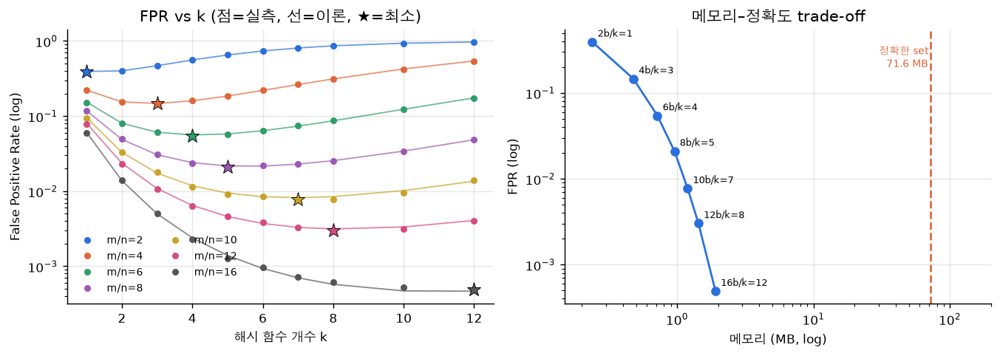

| m/n (비트/원소) | 메모리 | 최소 FPR을 낸 k | 실측 FPR | 이론 FPR | 이론 최적 k* |
|---|---|---|---|---|---|
| 2 | 244 KB | 1 | 39.26% | 39.35% | 1 |
| 4 | 488 KB | 3 | 14.62% | 14.69% | 3 |
| 6 | 733 KB | 4 | 5.44% | 5.61% | 4 |
| 8 | 977 KB | 5 | 2.10% | 2.17% | 6 |
| 10 | 1.19 MB | 7 | 0.77% | 0.82% | 7 |
| 12 | 1.43 MB | 8 | 0.30% | 0.31% | 8 |
| 16 | 1.91 MB | 12 | 0.049% | 0.047% | 11 |

- 모든 m/n에서 FPR은 k에 대해 **U자 곡선**을 그렸고, 최솟값은 이론 k* = (m/n)·ln2와 ±1 이내에서 나왔다.
- 예를 들어 m/n = 4에서 k를 3 → 12로 늘리면 FPR이 14.6% → **53.9%**로 3.7배 나빠진다. 해시를 늘리면 원소마다 켜는 비트가 늘어나 배열이 빨리 포화되기 때문이다.
- 메모리를 늘리면 FPR은 **지수적으로** 떨어진다. 원소당 약 4.8비트(= 1.44·log₂10)를 추가할 때마다 FPR이 1/10이 된다. 실측도 4 → 8 → 12 → 16비트에서 14.6% → 2.1% → 0.30% → 0.049%로 4비트당 약 7배씩 줄었다.

**용량 초과 실험**: 같은 m/n = 10 설계를 n/4 = 250,000개 용량으로 잡고 100만 개를 넣었다.

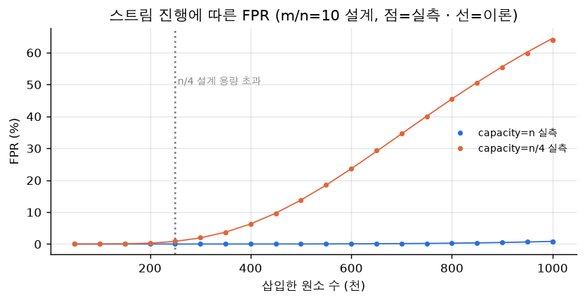

정상 설계(capacity = n)는 끝까지 FPR이 1% 이하를 유지했다. 반면 n/4 설계는 설계 용량을 넘는 순간부터 FPR이 급증했다: 20만 개에서 0.37%, 45만 개에서 9.6%, 100만 개에서 **64.0%**. 두 곡선 모두 이론식을 정확히 따른다. Bloom Filter는 **n을 미리 알아야 하는** 자료구조라는 점이 가장 큰 운영상 약점이다.

### 6.2 Count-Min Sketch — 빈도 추정 오차

**메인 설정** (ε = 0.01, δ = 0.01 → w = 272, d = 5, 5.3 KB, seed 5개). 정답은 영화 3,706편의 정확한 평점 수.

| 지표 | 기본 CMS | Conservative Update |
|---|---|---|
| 평균 절대오차 (MAE) | 1,885 ± 27 | **911 ± 11** (−52%) |
| 최대 절대오차 | 5,535 ± 524 | 2,612 ± 45 |
| εN 상한(9,996) 이내 비율 | **100%** | **100%** |
| 과소추정 (f̂ < f) | 0건 | 0건 |
| 상대오차 중앙값 | 1,427% | 819% |
| 정확히 맞춘 영화 비율 | 0% | 1.4% |
| Top-50 인기 영화 precision | 0.36 ± 0.05 | **0.78 ± 0.06** |

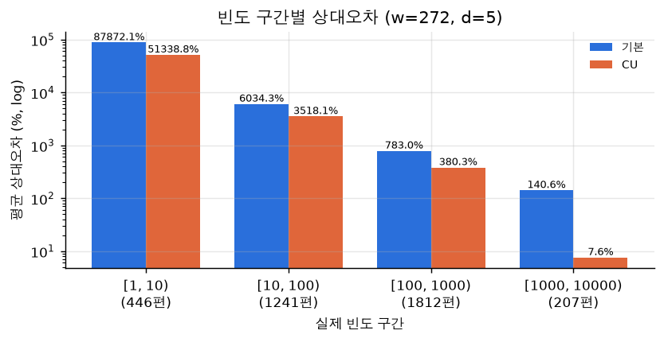

**이론 보장은 완벽히 지켜졌지만, 실제 쓸모는 빈도 구간에 따라 극단적으로 갈렸다.**

- CMS의 보장은 "오차 ≤ ε·N"이라는 **전체 스트림 크기 N에 대한 덧셈 오차**다. 영화 3,706편을 272칸에 넣으면 칸 하나에 평균 13.6편이 섞이고, 행 하나의 잡음은 평균 (N − f)/w ≈ 3,680이 된다. 5개 행의 최솟값을 취해도 약 1,900이 남는다.
- 이 잡음 크기는 빈도 구간과 거의 무관하게 일정하다(기본 CMS 1,858 ~ 1,912). 그래서 평점이 10회 미만인 희귀 영화(446편)는 상대오차가 **평균 879배**다. 반면 1,000회 이상인 인기 영화(207편)는 141%, CU를 쓰면 **7.6%**까지 줄어든다.
- 결론: CMS는 **heavy hitter(빈도가 εN에 가까운 항목)를 찾는 용도**로는 쓸 만하지만, 롱테일 항목의 정확한 개수를 묻는 데는 맞지 않는다.

**파라미터 스윕** (w 9종 × d 7종 × {기본, CU} = 126개 설정)

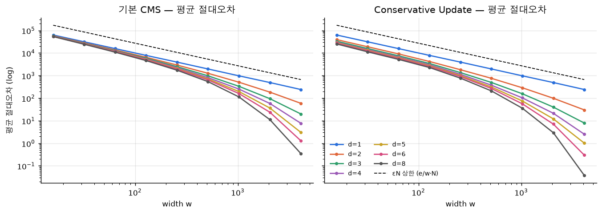

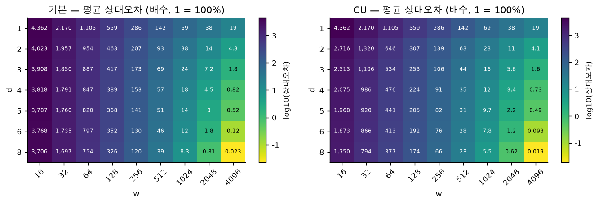

| w × d | 메모리 | MAE 기본 / CU | 평균 상대오차 기본 / CU | Top-50 precision 기본 / CU |
|---|---|---|---|---|
| 64 × 4 | 1 KB | 12,119 / 6,648 | 847× / 476× | 0.12 / 0.06 |
| 256 × 4 | 4 KB | 2,226 / 1,134 | 153× / 91× | 0.26 / 0.74 |
| 1024 × 4 | 16 KB | 252 / 102 | 18× / 12× | 0.74 / 1.00 |
| 4096 × 4 | 64 KB | 7.7 / 2.5 | 0.82× / 0.73× | 0.98 / 1.00 |
| 4096 × 8 | 128 KB | 0.35 / 0.04 | 0.023× / 0.019× | 1.00 / 1.00 |

- **width w**가 오차의 크기를 결정한다. 오차는 w가 2배가 될 때마다 절반 이상으로 줄어든다(d = 4, w = 16~1024 구간의 log-log 기울기 약 −1.3). 다만 w가 고유 항목 수(3,706)에 가까워지면 충돌 자체가 사라지면서 더 빠르게 줄어든다.
- **depth d**가 주는 이득은 **체감한다**. w = 1024에서 MAE는 d = 1 → 2일 때 973 → 507로 크게 줄지만, d = 6 → 8일 때는 160 → 113에 그친다.
- CU는 모든 설정에서 MAE가 기본형 이하였다(d = 1에서는 두 방식이 같다). 단, w = 64처럼 극단적으로 좁으면 Top-K precision이 오히려 낮았다(0.12 → 0.06). 모든 칸이 포화된 상태에서는 CU의 "최솟값만 올리기" 규칙이 순위 정보를 지우기 때문이다.

**같은 메모리 예산에서 width와 depth 배분 (counter 수 w·d 고정)**

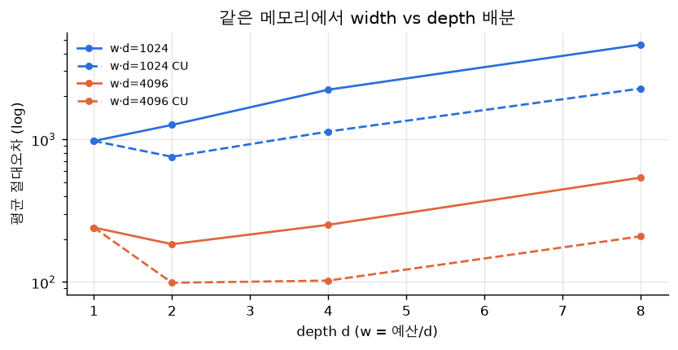

| 예산 (카운터 수) | d = 1 | d = 2 | d = 4 | d = 8 |
|---|---|---|---|---|
| 1,024개 (4 KB), 기본 MAE | **973** | 1,261 | 2,226 | 4,611 |
| 1,024개 (4 KB), CU MAE | 973 | **754** | 1,134 | 2,271 |
| 4,096개 (16 KB), 기본 MAE | 241 | **184** | 252 | 539 |
| 4,096개 (16 KB), CU MAE | 241 | **99** | 102 | 209 |

**메모리가 고정되면 depth를 늘리는 것은 득이 아니라 손해일 수 있다.** d를 2배로 늘리면 w가 절반으로 줄어 각 행의 잡음이 2배가 된다. min 연산이 이 손해를 상쇄하려면 행들 사이의 오차 편차가 커야 하는데, 이 데이터에서는 d = 1~2에서 최적이 나왔다. 이론적으로도 d는 "오차가 상한을 넘을 **확률** δ"를, w는 "오차의 **크기** ε"를 조절한다. 실제로 within-bound 비율은 w가 큰 d = 1 설정에서만 0.88~0.94로 낮았고, d ≥ 3에서는 모든 w에서 0.998 이상이었다. 따라서 평균 오차를 줄이려면 width에, 최악의 경우를 막으려면 depth에 메모리를 써야 한다.

### 6.3 HyperLogLog — 고유 개수 추정 오차

**메인 설정** (p = 14, m = 16,384, 16 KB, seed 20개)

| 대상 | 실제 고유 수 | HLL 추정 (평균 ± 표준편차) | 상대 표준오차 | 이론 1.04/√m |
|---|---|---|---|---|
| (user, movie) 쌍 | 1,000,209 | 1,002,578 ± 8,445 | **0.84%** | 0.81% |
| 사용자 | 6,040 | 6,045 ± 31 | 0.51% | 0.81% |
| 영화 | 3,706 | 3,705 ± 19 | 0.52% | 0.81% |

- 100만 개 규모의 고유 쌍은 이론 표준오차와 거의 같다. 20개 seed의 평균 편향은 +0.24%로, 사실상 **불편 추정**이다.
- 사용자·영화처럼 n < 2.5m(= 40,960)인 경우에는 **Linear Counting 보정**이 작동했다. 그래서 오차가 이론 1.04/√m보다 작았다. 이 구간에서는 "빈 레지스터 수"가 더 정확한 정보이기 때문이다.

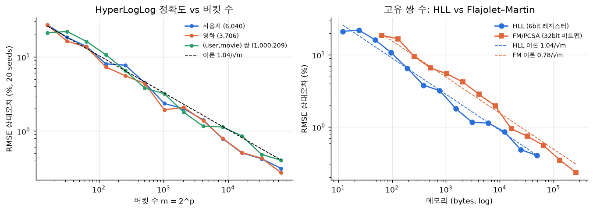

**버킷 수 스윕** (p = 4 ~ 16, 대상 3종 × seed 20개, RMSE 상대오차)

| p (m) | 4 (16) | 6 (64) | 8 (256) | 10 (1,024) | 12 (4,096) | 14 (16,384) | 16 (65,536) |
|---|---|---|---|---|---|---|---|
| 메모리 (6비트 패킹) | 12 B | 48 B | 192 B | 768 B | 3 KB | 12 KB | 48 KB |
| 쌍 (100만) | 21.2% | 16.2% | 6.5% | 3.2% | 1.16% | 0.86% | 0.41% |
| 사용자 (6,040) | 27.0% | 13.9% | 7.7% | 2.4% | 1.42% | 0.51% | 0.31% |
| 이론 1.04/√m | 26.0% | 13.0% | 6.5% | 3.25% | 1.62% | 0.81% | 0.41% |

오차는 이론선 1.04/√m을 정확히 따랐다. **메모리를 4배 늘려야 오차가 절반**이 되는 제곱근 법칙이다. 12바이트만으로도 100만 개 규모를 ±21% 안에서 추정했다.

**HLL vs Flajolet–Martin (PCSA)**: 고유 쌍 100만 개 기준으로 비교했다.

- **FM은 같은 버킷 수에서 오차 상수가 더 작다**(p = 14에서 0.55% vs 0.86%). 하지만 비트맵이 32비트라 메모리가 HLL(6비트)의 5.3배다. **같은 메모리 기준으로는 HLL이 앞선다**(오른쪽 그래프에서 HLL 곡선이 아래쪽에 있다).
- **FM의 치명적 약점은 n ≪ m인 구간이다.** 6,040명을 m = 16,384 버킷으로 세면 FM은 **24,073명(+299%)**으로 추정했고, m = 65,536에서는 +1,348%였다. 비어 있는 비트맵도 R = 0으로 기여해서, 공식 E = (m/φ)·2^(mean R)의 하한이 m/φ(m = 16,384이면 21,181)가 되기 때문이다. HLL은 Linear Counting으로 이 구간을 처리해 같은 조건에서 0.5% 오차를 냈다.

**스트림 진행에 따른 추정**

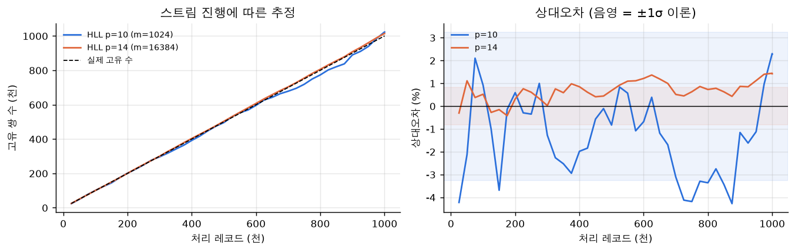

- p = 14는 스트림 전 구간에서 상대오차가 −0.4% ~ +1.4%였다.
- p = 10은 −4.3% ~ +2.3%로 흔들렸다. 대부분 이론 ±1σ(3.25%) 안이지만, 오차가 연속적으로 같은 방향에 머무는 구간이 있다. 같은 레지스터 상태를 계속 갱신하므로 시점 간 오차가 강하게 상관되기 때문이다.

**분산 병합(merge)**: 스트림을 두 노드에 번갈아 나눠 각각 HLL(p = 14)로 사용자를 셌다.

- 노드 A와 B는 각각 6,019명으로 추정했다. 모든 사용자가 두 노드에 모두 등장하므로, 단순히 더하면 12,037명으로 2배 과대가 된다.
- 레지스터별 max로 병합한 결과는 **단일 노드 HLL과 레지스터가 비트 단위로 동일**했다(6,019명, 실제 6,040명). HLL은 중복을 제거한 합집합 개수를 **손실 없이** 계산할 수 있다.

## 7. 메모리 사용량 비교 결과

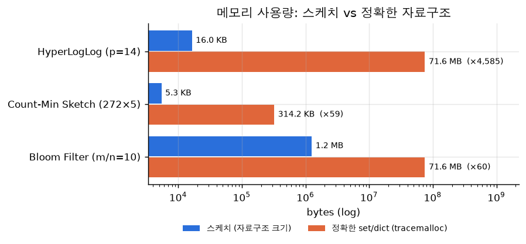

| 알고리즘 (메인 설정) | 자료구조 크기 | tracemalloc 실측 (current / peak) | 정확한 자료구조 (tracemalloc) | 절감 배수 |
|---|---|---|---|---|
| Bloom Filter (m/n = 10) | 1,250,262 B (1.19 MB) | 1.21 MB / 1.23 MB | set(쌍 100만 개) 71.6 MB | **60배** |
| Count-Min Sketch (272 × 5) | 5,440 B (5.3 KB) | 6.4 KB / 28.3 KB | dict(영화 3,706개) 314.2 KB | **59배** |
| HyperLogLog (p = 14) | 16,384 B (16 KB; 6비트 패킹 시 12 KB) | 16.5 KB / 38.3 KB | set(쌍 100만 개) 71.6 MB | **4,585배** |

- tracemalloc 실측값이 자료구조 크기와 거의 같다. `bytearray`·`array('I')`로 구현해 Python 객체 오버헤드가 없었기 때문이다. peak가 조금 더 큰 것은 갱신 중에 잠시 생기는 키 문자열·리스트 때문이다.
- 정확한 set은 원소당 약 **75바이트**(키 bytes 객체 + 해시 테이블 슬롯)를 쓴다. Bloom은 원소당 **10비트(1.25바이트)**를 쓴다.
- **메모리가 무엇에 비례하는가**가 세 알고리즘의 근본적 차이다.
  - Bloom: n에 비례한다(원소당 고정 비트). 원소 크기와는 무관하다.
  - CMS: 1/ε에 비례한다. n과 고유 항목 수 모두와 무관하다.
  - HLL: log log n 수준으로, **사실상 상수**다. 6천 명이든 100만 쌍이든 같은 16 KB다.
- CMS의 메모리 이득은 이 데이터에서 상대적으로 작다(59배). 고유 항목이 3,706개뿐이어서 정확한 dict도 314 KB에 불과하기 때문이다. 오차를 1 미만으로 낮추려면(w = 4096, d = 8, 128 KB) 절감 배수가 **2.5배**로 떨어진다. **CMS는 고유 키 수가 w보다 훨씬 클 때(예: 수억 개의 IP·URL) 진가가 나온다.**

## 8. 처리 시간 비교 결과

전체 스트림 1회 처리 시간이다(순차 실행, 3회 중 중앙값, 파싱 포함). "알고리즘 순수 비용"은 같은 키를 만드는 파싱 기준 시간을 뺀 값이다.

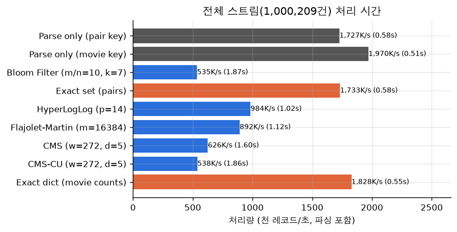

| 방법 | 전체 시간 | 처리량 | 순수 비용 (μs/원소) |
|---|---|---|---|
| 파싱만 (pair 키 / movie 키) | 0.58 s / 0.51 s | 1.73M / 1.97M rec/s | — |
| **HyperLogLog** (p = 14) | 1.02 s | **984K rec/s** | **0.44** |
| Flajolet–Martin (m = 16,384) | 1.12 s | 892K rec/s | 0.54 |
| Count-Min Sketch (272 × 5) | 1.60 s | 626K rec/s | 1.09 |
| CMS-CU (272 × 5) | 1.86 s | 538K rec/s | 1.35 |
| Bloom Filter (m/n = 10, k = 7) 삽입 | 1.87 s | 535K rec/s | 1.29 |
| Bloom Filter 질의 (음성 10만 개) | 0.072 s | 1.38M query/s | — |
| 정확한 set (쌍) | 0.58 s | 1.73M rec/s | ≈ 0 |
| 정확한 dict (영화 빈도) | 0.55 s | 1.83M rec/s | 0.04 |

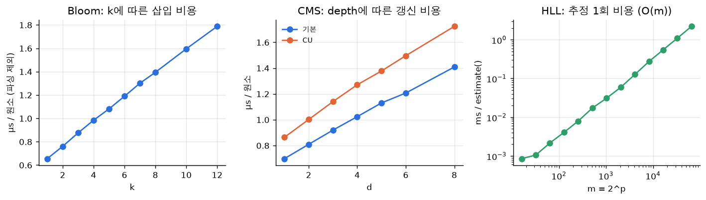

- **CPython에서는 정확한 set/dict가 스케치보다 1.8~3.2배 빠르다.** set/dict는 C로 구현된 해시 테이블이라 갱신 비용이 파싱 비용에 묻힌다. 반면 스케치는 원소마다 BLAKE2b 호출(약 0.5 μs)과 Python 루프를 돈다. 이 실험에서 스케치의 이득은 **속도가 아니라 메모리**다.
  - C/Java 구현(Redis, Guava 등)에서는 스케치 갱신이 수십 ns 수준이다. 또한 스케치는 수 KB~MB라 CPU 캐시에 들어가지만, 수 GB짜리 해시 테이블은 캐시 미스와 GC 부담이 커진다. 규모가 커질수록 이 관계가 역전된다.
- **해시 수와 depth는 시간에 선형으로 비용을 더한다.**
  - Bloom: k = 1 → 12에서 0.65 → 1.79 μs/원소, 해시 위치 1개당 약 0.1 μs.
  - CMS: d = 1 → 8에서 0.70 → 1.41 μs. CU는 min을 먼저 계산하므로 같은 d에서 약 22~24% 더 느리다.
  - 반면 CMS의 w(64 → 4096)와 HLL의 p(4 → 16)는 **갱신 시간에 영향이 없다**(0.95~1.01 μs, 0.50~0.54 μs). 갱신이 칸 하나만 건드리기 때문이다.
- HLL의 **추정(estimate)**은 레지스터 m개를 모두 훑으므로 O(m)이다. p = 14에서 0.5 ms, p = 16에서 2.2 ms. 갱신마다 추정할 일은 없으므로 실무에서는 문제가 되지 않는다.
- Bloom 질의는 음성일 때 첫 0비트에서 바로 멈춘다(early exit). 그래서 음성 질의(1.38M/s)가 양성 질의보다 2.4배 빠르다(양성 100만 개 1.71 s, 파싱 포함).

## 9. 알고리즘별 장단점 분석

| | Bloom Filter | Count-Min Sketch | HyperLogLog |
|---|---|---|---|
| **답하는 질문** | 있는가? | 몇 번인가? | 몇 종류인가? |
| **오차 방향** | 거짓 양성만 (FN = 0) | 과대추정만 | 양방향, 불편 |
| **메모리 스케일** | O(n) (원소당 ~10비트) | O(1/ε · log 1/δ) | O(log log n) ≈ 상수 |
| **이번 실험 정확도** | FPR 0.82% (이론과 일치) | heavy hitter 양호, 롱테일 상대오차 수백~수천 % | 0.84% (이론과 일치) |
| **메모리 절감** | 60배 | 59배 (고유 키가 적어 이득 작음) | 4,585배 |
| **속도 (Python)** | 535K/s (k에 비례) | 626K/s (d에 비례) | **984K/s** (파라미터 무관) |
| **병합** | 같은 (m, k, seed)면 비트 OR | 같은 (w, d, seed)면 행렬 합 | 같은 (p, seed)면 레지스터 max, **무손실** |
| **삭제** | 불가 (Counting BF 필요) | 기본형은 가능, CU는 불가 | 불가 |
| **사전 정보 필요** | **n을 미리 알아야 함** (초과 시 FPR 64%) | 고유 키 수 대비 w 설계 필요 | 불필요 |
| **강점** | 질의가 매우 빠름(음성 조기 종료), FN이 없어 "확실히 없음"을 보장 | 임의 키의 빈도, 스트림 중간에도 질의 가능, 업데이트가 단순 | 극소 메모리, 예측 가능한 오차, 분산 집계 |
| **약점** | 원소 목록을 꺼낼 수 없음, 용량 초과에 취약, 최적 k를 벗어나면 급격히 악화 | 덧셈 오차라 저빈도 항목은 무의미, 항목 목록 없음(Top-K는 별도 힙 필요) | 카디널리티만 답함, 작은 m에서 분산이 큼 |

Flajolet–Martin은 큰 n에서는 HLL과 비슷하게 정확했다. 그러나 레지스터가 5.3배 크고, n ≪ m 구간에서 수백 % 편향이 생겨 실무 대안이 되기 어렵다. 이것이 HLL이 FM을 대체한 이유를 실험으로 확인한 결과다.

## 10. 최종 분석 질문

<div class="qa" markdown="1">

### Q1. 정확도와 메모리 사이에는 어떤 trade-off가 있었는가?

**세 알고리즘 모두 "메모리를 더 쓰면 더 정확"했지만, 메모리 1바이트당 정확도 개선 속도는 알고리즘마다 전혀 달랐다.**

- **Bloom Filter — 지수적 개선**: 원소당 비트를 4 → 8 → 12 → 16으로 늘리자 FPR이 14.6% → 2.1% → 0.30% → 0.049%로 줄었다. 약 4.8비트를 추가할 때마다 FPR이 1/10이 되어, 비용 대비 효율이 가장 좋다.
- **HyperLogLog — 제곱근 개선**: 오차는 1.04/√m을 따랐다(12 B에서 21%, 12 KB에서 0.86%, 48 KB에서 0.41%). **메모리를 4배로 늘려야 오차가 절반**이 되는 수확 체감 구조라, 실무 최적점은 수 KB~16 KB 근처다.
- **Count-Min Sketch — 선형 개선이지만 "덧셈 오차"**: 평균오차가 w에 반비례해 줄었다. 하지만 오차가 εN 단위라서, 롱테일 항목까지 정확하게 맞추려면 w가 고유 키 수를 넘어야 한다(4096 × 8 = 128 KB). 이 지점에서는 dict(314 KB)와 메모리 차이가 2.5배로 줄어 스케치를 쓸 이유가 약해진다.
- 정확한 set/dict는 n에 비례해 커진다(쌍 100만 개에 71.6 MB). **HLL의 16 KB는 n이 1억이 되어도 그대로다.** 데이터가 클수록 trade-off는 스케치 쪽으로 기운다.

</div>

<div class="qa" markdown="1">

### Q2. 파라미터 증가가 항상 성능 향상으로 이어졌는가?

**아니다. "메모리 총량을 늘리는 것"만 단조적으로 도움이 되었고, 나머지 파라미터는 최적점이 있거나 오히려 악화를 불렀다.**

1. **Bloom의 해시 수 k**: 최적 k* = (m/n)·ln2를 넘으면 FPR이 다시 증가했다(m/n = 4에서 k = 3 → 12일 때 14.6% → **53.9%**). 처리 시간도 k에 비례해 2.7배 늘었다.
2. **CMS의 depth d (같은 메모리)**: 카운터 1,024개 예산에서 d = 1의 MAE가 973, d = 8은 **4,611**(4.7배 악화)이었다. d를 늘리면 w가 줄어드는 대가가 min 연산의 이득보다 컸다. d는 갱신 시간도 선형으로 늘린다(0.70 → 1.41 μs).
3. **FM의 버킷 수 m**: 사용자 6,040명을 셀 때 m을 1,024 → 4,096 → 65,536으로 키우자 오차가 2.1% → 43.5% → **1,348%**로 폭증했다(n ≪ m 편향).
4. **HLL의 p**: 정확도는 단조 개선되었지만 수확이 체감했다(p 14 → 16에서 메모리 4배, 오차 0.86% → 0.41%). 추정 시간은 O(m)으로 4배 늘었다.
5. **입력 n (용량)**: 설계 용량을 넘겨 넣으면 Bloom FPR이 0.8% → 64%로 무너졌다. 파라미터는 **데이터 규모와 짝을 이뤄야** 의미가 있다.

</div>

<div class="qa" markdown="1">

### Q3. 어떤 알고리즘이 가장 실용적이라고 판단되는가?

**HyperLogLog가 가장 실용적이다.**

- **최소 메모리·최대 절감**: 16 KB로 100만 개를 0.84% 오차로 셌다. set 대비 4,585배 작다.
- **사전 지식이 필요 없다**: n을 몰라도 되고, 6천 개든 100만 개든 같은 설정으로 이론 오차 이내다. Bloom은 n을 미리 알아야 하고, CMS는 고유 키 수를 고려해 w를 정해야 한다.
- **가장 빠르다**: 원소당 해시 1회와 레지스터 1칸 갱신으로, 스케치 중 가장 높은 984K rec/s를 냈다.
- **오차를 예측할 수 있다**: 1.04/√m이 seed 20개 실측과 일치해, 서비스 SLA로 바로 쓸 수 있다.
- **분산 병합이 무손실이다**: 노드별 HLL을 max로 합친 결과가 단일 HLL과 비트 단위로 동일했다. 서버·시간대별 집계를 사후에 자유롭게 합칠 수 있다.

Bloom Filter도 이론과 정확히 일치하는 예측 가능성과 FN = 0 보장 덕분에 실용성이 높다(2위). CMS는 강력하지만, 롱테일에서 상대오차가 수백 배까지 커지므로 "heavy hitter 전용"이라는 사용 범위를 이해하고 써야 한다.

</div>

<div class="qa" markdown="1">

### Q4. 실제 서비스 로그 분석에 적용한다면 어떤 알고리즘을 선택할 것인가?

**기본 선택은 HyperLogLog이고, 질문 유형에 따라 세 알고리즘을 조합한다.** 서비스 로그의 핵심 지표 대부분이 "몇 명이 / 몇 종류가"를 묻는 카디널리티 문제이기 때문이다.

| 서비스 질문 | 선택 | 근거 (이번 실험) |
|---|---|---|
| DAU/MAU, 페이지별 순방문자(UV), 고유 IP 수 | **HyperLogLog** (p = 14) | 키당 16 KB로 0.8% 오차, 서버·일자별 HLL을 merge해 주간·월간 UV 산출 (Redis `PFADD`/`PFMERGE`와 같은 원리) |
| 인기 상품·검색어 Top-K, 트래픽 폭주 IP·DDoS 탐지 | **Count-Min Sketch + CU + Top-K 힙** | heavy hitter 구간 상대오차 7.6%, Top-50 precision 0.78 → w를 키우면 1.0. 과대추정만 하므로 "임계값 미만이면 확실히 정상"이라는 판정이 가능 |
| 이벤트 중복 제거, "이미 본 콘텐츠" 필터, DB 조회 전 존재 확인 | **Bloom Filter** | FN = 0이라 "없다"는 판정을 믿을 수 있음. FPR 1%에 원소당 10비트. 단, 일 단위 등으로 용량을 고정해 회전(rotation)시켜야 함(용량 초과 시 FPR 64%) |

하나만 고른다면 **HyperLogLog**다. 메모리·속도·병합성·운영 편의성(사전 설계 불필요) 네 가지를 모두 갖춘 알고리즘은 이번 실험에서 HLL뿐이었다.

</div>

## 11. 결론

1. 세 스트리밍 알고리즘을 순수 Python으로 직접 구현했다. MovieLens 1M 스트림(1,000,209건)에서 **Bloom FPR 0.815%(이론 0.819%)**, **HLL 표준오차 0.84%(이론 0.81%)**로, 이론 성능을 실측으로 재현했다. CMS는 εN 상한을 100% 만족했다.
2. 메모리 절감은 Bloom 60배, CMS 59배, **HLL 4,585배**였다. 반면 CPython에서는 C로 구현된 set/dict가 오히려 1.8~3.2배 빨라서, 스케치의 이득은 속도가 아니라 **메모리·확장성·병합성**에 있다는 점을 확인했다.
3. 파라미터는 "클수록 좋다"가 아니었다. Bloom의 k, 같은 메모리에서 CMS의 d, FM의 m에는 최적점이 있었고, 이를 넘으면 정확도와 속도가 모두 나빠졌다. 메모리 총량만이 단조적으로 도움이 되었으며, 그 효율도 Bloom(지수) > CMS(선형) > HLL(제곱근) 순으로 달랐다.
4. 알고리즘 선택은 질문의 형태(있는가 / 몇 번인가 / 몇 종류인가)와 데이터 분포(롱테일 여부), 그리고 사전 정보(n을 아는가)로 결정해야 한다. 서비스 로그에는 HLL을 기본으로 두고, heavy hitter에는 CMS-CU, 중복 제거에는 Bloom을 조합하는 구성을 권장한다.

**한계와 확장**: 시간 측정은 CPython 기준이라 C 구현과의 절대 속도 비교는 하지 않았다. CMS는 고유 키 수가 적은 데이터(3,706편)여서 메모리 이득이 과소평가되었다. 후속 과제로는 고유 키가 수억 개인 데이터(예: Wikipedia Clickstream)에서 CMS를 평가하고, Counting Bloom Filter(삭제 지원)와 HLL++(희소 표현)를 비교해 볼 수 있다.
